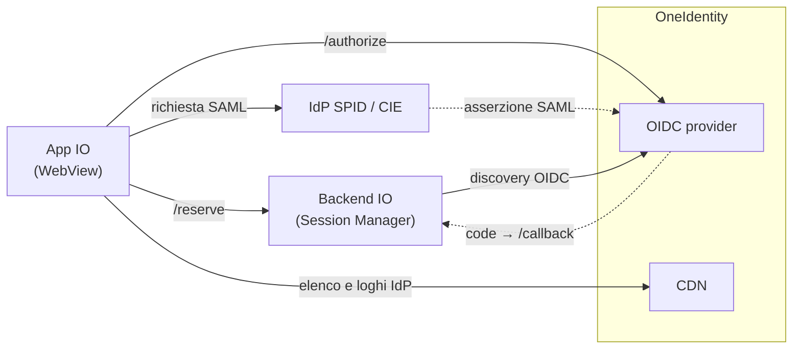
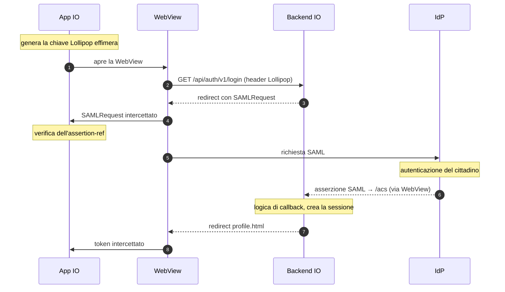
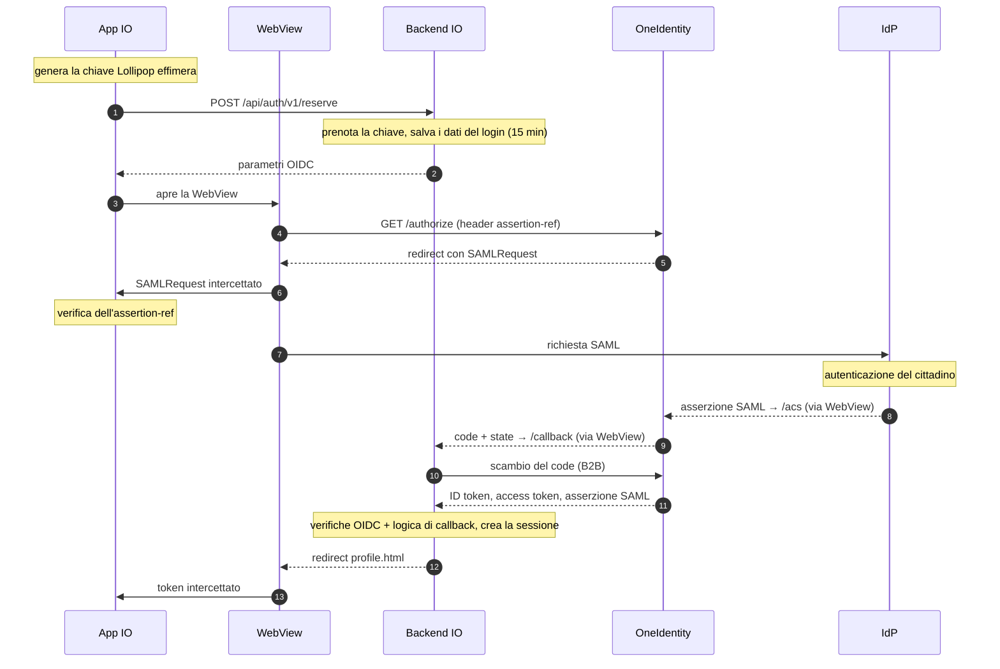

# Autenticazione in App IO

## Contesto

**Prima.** IO gestiva da sé l'intero stack di login: il backend IO costruiva le richieste SAML e verificava le asserzioni degli Identity Provider. Patch di sicurezza ed evoluzioni, come il login dei minori, ricadevano tutte sul team IO.

**OneIdentity.** È il servizio interno con cui i prodotti PagoPA autenticano i cittadini via SPID e CIE. Verso gli IdP parla SAML, verso i prodotti espone un flusso OIDC. È mantenuto da un team dedicato e permette a PagoPA di avere una sola adesione AgID.

**Adesso.** IO è un client OIDC di OneIdentity. A IO restano:

- l'integrazione con il flusso OIDC (`/reserve`, `/authorize`, `/callback`);
- Lollipop, la proof of possession dei cittadini (sezione 5);
- le operazioni sul dispositivo: lettura NFC della CIE con PIN e passaggio all'app CieID.

**Transizione.** IO sta migrando da uno stack all'altro: lo stack IO è in dismissione, lo stack OneIdentity è in rollout per dispositivo (sezione 4.1) e a regime resterà l'unico. Nel frattempo i due stack convivono; per il cittadino flussi e schermate non cambiano.

I termini tecnici sono spiegati nel [glossario](#glossario) in fondo.

### Chi parla con chi

Con lo stack OneIdentity l'app parla con quattro sistemi. Le frecce tratteggiate sono redirect che passano dal browser della WebView.

## 1. I tre flussi

L'app distingue tre flussi di login attraverso il tipo `LoginType`. Ognuno può passare da uno dei due stack, IO o OneIdentity, e usa Lollipop allo stesso modo; cambiano quando il flusso parte, quali controlli fa e dove porta il cittadino alla fine. Se l'opt-in è attivo, in tutti e tre il cittadino sceglie anche la durata della sessione (sezione 3).

| Flusso                  | `LoginType` | Quando parte                                                                                | Metodi                 | Differenze                                                                                                | Al termine                                          |
| ----------------------- | ----------- | ------------------------------------------------------------------------------------------- | ---------------------- | --------------------------------------------------------------------------------------------------------- | --------------------------------------------------- |
| Primo login             | `auth`      | Cittadino non autenticato, dalla landing                                                    | SPID, CIE + PIN, CieID | —                                                                                                         | Avvio dell'app                                      |
| Login a sessione attiva | `reauth`    | Sessione in scadenza: schermata bloccante all'avvio, poi banner                             | SPID, CIE + PIN, CieID | L'identità deve coincidere con quella della sessione: l'app invia l'hash del codice fiscale (sezione 4.4) | Home messaggi, con la nuova sessione e senza logout |
| Firma con IO            | `FCI_auth`  | Il cittadino avvia una firma e la sessione non è L3 (controllo attivabile da remote config) | CIE + PIN              | Login a sessione attiva con `flow: "FCI"` e livello L3                                                    | Ritorno alla firma                                  |

## 2. Metodi di identificazione

I metodi sono gli stessi nei due stack. Il livello è quello che l'app chiede all'IdP (`SpidL2` o `SpidL3`).

| Metodo    | Come avviene                                                                                                                                        | Livello richiesto | Note                                                                                                                                                                                                                              |
| --------- | --------------------------------------------------------------------------------------------------------------------------------------------------- | ----------------- | --------------------------------------------------------------------------------------------------------------------------------------------------------------------------------------------------------------------------------- |
| SPID      | Il cittadino sceglie l'IdP dall'elenco e si autentica nella WebView                                                                                 | L2                | Elenco IdP: nello stack IO dai contenuti statici di IO (`/spid/idps/list.json`, con un elenco di riserva nell'app); nello stack OneIdentity da OneIdentity (URL in remote config), con i loghi dalla CDN `assets.oneid.pagopa.it` |
| CIE + PIN | Il cittadino inserisce il PIN; la WebView avvia il login, l'app legge la carta via NFC in modo nativo, poi la WebView completa con consenso e token | L3                | Unico metodo ammesso dalla Firma con IO. Nello stack IO, se l'NFC è spento, una schermata chiede di attivarlo                                                                                                                     |
| CieID     | La WebView avvia il login e passa all'app CieID; il cittadino si autentica lì e torna a IO                                                          | L2                | Se l'app CieID non è installata, l'app lo segnala. Se nell'app CieID è configurato solo il livello 3, il login si completa con L3                                                                                                 |

## 3. Ciclo di vita della sessione

La durata della sessione dipende dal tipo di login: normale (30 giorni) o fast login (`LV`, 365 giorni). Il fast login richiede il feature flag `fastLogin`; se è attivo anche l'opt-in, decide il cittadino, altrimenti è sempre attivo. Il tipo viaggia con la richiesta di login (sezione 4.4).

| Fase                                                                     | Login normale             | Fast login (LV)                                                                                                   |
| ------------------------------------------------------------------------ | ------------------------- | ----------------------------------------------------------------------------------------------------------------- |
| Durata della sessione                                                    | 30 giorni                 | 365 giorni                                                                                                        |
| Token scaduto durante la sessione (401)                                  | Sessione scaduta → logout | Rinnovo del token: l'app chiede conferma e il codice di sblocco, poi `nonce` + `/fast-login` firmata con Lollipop |
| Sblocco dell'app con il codice di IO, dopo almeno 2 minuti in background | Nessuna azione            | Rinnovo silenzioso del token                                                                                      |

**Avviso di scadenza.** Vale per entrambi i tipi, se il login a sessione attiva è abilitato da remote config. Quando mancano meno giorni della soglia (`loginConfig.notifyExpirationThreshold`, con valori distinti per login normale e fast login), all'avvio compare una schermata bloccante, una volta sola; da lì in poi compare il banner. Entrambi portano al login a sessione attiva, che crea una nuova sessione senza logout. Se il cittadino ignora l'avviso, alla scadenza dovrà rifare il primo login.

## 4. I due stack

### 4.1 Selezione dello stack

Lo stack si sceglie per dispositivo. Vale il flag locale della Login Config Screen (sezione 7); se non è impostato, decide il rollout percentuale da remote config, calcolato sul deviceId (`isOneIdentityLoginEnabledSelector`). Lo stack con cui è stata aperta la sessione resta salvato (`isOneIdentityLogin`).

### 4.2 Stack IO (in dismissione)

Il backend IO parla SAML direttamente con l'IdP: costruisce la richiesta e verifica l'asserzione.

I dati del login viaggiano negli header e nella query della chiamata 2 (sezione 4.4).

### 4.3 Stack OneIdentity (in rollout)

OneIdentity parla SAML con l'IdP; IO parla OIDC con OneIdentity.

La `/reserve` è chiamata direttamente dall'app e restituisce i parametri per l'`/authorize`: `authorization_endpoint`, `client_id`, `redirect_uri`, `state`, `nonce`, `acr_values`. Con questi l'app compone l'URL dell'`/authorize`, aggiungendo l'`idp` scelto, `scope=openid` e `response_type=code`. In questo stack l'`/acs` è di OneIdentity, non del backend IO. Dal passo 12 in poi il flusso è identico allo stack IO.

Passaggi introdotti con OneIdentity: 1, 2, 4, 9, 10, 11.

### 4.4 Cosa invia l'app al login

| Dato                                                      | Stack IO (`GET /api/auth/v1/login`)                      | Stack OneIdentity                                          |
| --------------------------------------------------------- | -------------------------------------------------------- | ---------------------------------------------------------- |
| Chiave pubblica Lollipop                                  | Header `x-pagopa-lollipop-pub-key`                       | `lollipop_pub_key` nel body della `/reserve`               |
| Algoritmo di hash della chiave                            | Header `x-pagopa-lollipop-pub-key-hash-algo`             | `lollipop_hash_algo` nel body della `/reserve`             |
| Tipo di login                                             | Header `x-pagopa-login-type: LV`, solo con il fast login | `login_type` (`LV` o `LEGACY`) nel body della `/reserve`   |
| Hash del codice fiscale, solo nel login a sessione attiva | Header `x-pagopa-current-user`                           | `current_user` nel body della `/reserve`                   |
| Livello richiesto                                         | `authLevel` (`SpidL2` o `SpidL3`) nella query            | `min_auth_level` nel body della `/reserve`                 |
| IdP scelto                                                | `entityID` nella query                                   | `idp` nella query dell'`/authorize`                        |
| Ambiente OneIdentity                                      | —                                                        | `env` (`PROD` o `UAT`) nel body della `/reserve`           |
| Impronta della chiave (assertion-ref)                     | —                                                        | Header `x-pagopa-lollipop-assertion-ref` sull'`/authorize` |

### 4.5 Cosa fa il backend

**Solo stack OneIdentity.** Alla `/reserve` il Session Manager prenota la chiave Lollipop e salva per 15 minuti i dati del login (tipo di login, utente corrente, assertion-ref, livello minimo, ambiente, nonce): un login avviato deve chiudersi entro questo tempo. Alla `/callback` riceve `code` e `state`, recupera quei dati e scambia il `code` con OneIdentity, ottenendo ID token, access token e asserzione SAML. Poi verifica che:

- il codice fiscale dell'ID token coincida con quello dell'asserzione SAML;
- l'`InResponseTo` dell'asserzione coincida con l'assertion-ref salvato: è l'ultimo anello del legame Lollipop (sezione 5);
- il livello ottenuto non sia inferiore a `min_auth_level` (nessun downgrade).

**Entrambi gli stack.** Dopo l'`/acs` nello stack IO e dopo la `/callback` nello stack OneIdentity, la logica di callback è la stessa:

1. login a sessione attiva: se il codice fiscale è diverso da quello della sessione, errore 1004;
2. utente bloccato: se la sessione è bloccata risponde 403; se il cittadino ha bloccato l'accesso da IO-Web, errore 1002;
3. revoca della sessione e della chiave Lollipop precedenti, attivazione della nuova chiave;
4. creazione del token di sessione, recupero o creazione del profilo IO, invio dell'evento di login;
5. redirect a `profile.html#token`.

Un errore tecnico in uno di questi passi restituisce 500.

### 4.6 Cosa fa l'app dopo il token

L'app salva il token nello stato di autenticazione, che è persistito nel Keychain, e avvia l'inizializzazione. La prima chiamata al backend verifica la sessione: se risponde 401, la sessione è scaduta oppure, con il fast login, parte il rinnovo del token (sezione 3). La stessa chiamata restituisce le informazioni di sessione, tra cui la scadenza (`expirationDate`, usata per l'avviso di scadenza) e il livello (`spidLevel`, usato dalla Firma con IO), oltre ai token per gli altri servizi.

### 4.7 Cosa è semplificato

- Sono omessi i redirect intermedi, la schermata di consenso dell'IdP, la lettura NFC della CIE (tra la richiesta SAML e l'asserzione) e il passaggio all'app CieID. Nel passo 11 dello stack OneIdentity sono unite due chiamate: lo scambio del `code` e il recupero dell'asserzione SAML con l'access token.
- **CIE + PIN.** Nello stack IO i redirect fino al `SAMLRequest` li segue l'app in modo nativo, non la WebView. Nello stack OneIdentity lo stesso comportamento si attiva da remote config; sempre da remote config si attiva, su Android, la pulizia dei cookie di sessione prima del login.
- I passaggi lato app sono verificati nel codice di io-app; quelli lato backend (sezione 4.5) vengono dalla design review di OneIdentity, in particolare dal [diagramma Login Happy Path](https://www.planttext.com/?text=dLPHR-Cs37wUVWMHlYJ65RiRC0mesk3S9hq5IzSiJWiSYi9GB2OHuaYU9AVhVlqeEN5iTxiUrWUXfYJouyUFL3vRnuqhTpdqfdej5VpAY-8LPjnjUin9boDqxOmLT4Lcik3AGJoR0RT0korpBq5hfLPmnnLVe-dvGtRNFdElS38AErgX54nmnvVS8lJYqifSSWFMQKFtmo63Gbh6x5OgSiDtyBjsc6ouq2zIhU4NndZfj2ftIpJGkrmEdpv-VEunTdK5SxHezWXNLtGeStBF7GRCZ1OuVpfRvYK-3mdX1LncEjVcmbk6JxFxPF5SNqSb2YsLE_cWb9WY6A3t59ISVI3B3r5qhOLdYr2YGsEZY07zeTf7q2-v0ssWC5eCWdadLKhGDscEUyohexbdFNMl1ORFh3G6bKjB0dBOptDPw28jocMwnTUeRTrmkqbvljQCC8D7ICJjpeS-mUdXK1M3eWkHumitsCY4ieYY19589r2-MXR_B55b24BoDUL5APrSUzz74hiSVa65ndDrFndTU7_qlu2YvWRwcHO8gro_3Be8MWoIL9t7I23QMHqZ1u6qWoUSoiQFQl82WnLn_sF6ytp9ioqGeQTgLWexOQY-e-YtyLUAFnydu_dZ-Fmo01cI_J6UFenf9n2vyBKwrEd1bubRMXqrmHnNBCibsIU2KR5ZglNKbvhIs4F_8LvuFSpczwF18RqeMYocvFZJpruSfKDxoZY0WWRTJ60dWr1g4kC5ATULHeN4cyVeqXlLHX79lD2A-i-hDqYsGfrIRm9Kz0DK2264CfYH9esaJvwPTCy9KWEgRpsVh3RoxqFp5SK1cMz-GSwbUwsKKQdHom3wJUg0h1la0iqWEBmvbgxsvnLtgmr9MDYgndl9eIvn_uXqmDuXu8-7yVmhpE9vV3TUZES9SU2rUL3UzsgEE3SIkxhhgYoixrRnk1y6P3lCzK_N43e7_yesNAqREgx6QLZ_ioqd8rZeBIhWb5QSPJIlAqCJIENe7I1rlabyDuNuMBfGX9RZT_1zEt0NFpoYaIkPSH_BjWR7X-hsMHSGTVwEPc-smMnBkpK3DxTmFeI4qojuEdnpIqVYZWxhYewyojvUcgXZ3oqqh2JceehZGfowxs7e-wBfgZaLeAyqqAEcQCmA7FpB1AzRu9gSA4-mVwIp_p-_xUxfR6qGrNDxRXnVyJV2Q5ShlAIVoHtzaFW7).

I componenti lato server (Session Manager, Redis, funzioni Lollipop e Profile, CosmosDB, Service Bus) sono nel [diagramma dei container IO–OneIdentity](https://www.plantuml.com/plantuml/uml/ZLPBZzis4BxxLqnrA6H0ZIyv5KKHFtOJ0OdjsWw2dXQKDFQoIv4gITbrYlxt3X-MxPMDpSNXShxvvi5lHlbWBDEshSNW9ovBqLO8lqtVZwRldwPAMiObwjylJEnxgt4qThzJLTTAzesvjBZJp78b0t2DUizBdBIc3vunomfcq9muJQtChEW3ALhJsXZwiPMbuty3DcwQ6BiFN5kbsIu2_sYnnNZJXtx38l8jyozC4gP6QVkuETg3qYzSxhhmWfU-4H-PnGCxlbd_2YjkfgnyfZG6bbk1a7Jl03FEgB7rhv0lVbb8XBn2IQ1ZClWy_dFnTVEqMIoVPejlytGu62nH6oNJrg3Eag_qcz3bO7qq5kkdYMfbnVGnvOgop2395_155PpYNMIT3E7V0K2NG5fxIF2WNyeZeTCAMMbXJYvxT7zVC81zPXPGiaAWWP9R_Xsb0Qk0bIKQ0qrR41POLNF9ZTN1ouHNCvJoV_sSbKHUPSbL1uOkqGXy-CS6J55aoQJbeg8dWObGvKkI9KuXJ1w1IujQCW6BV3Q5WsPDWngOTb5WlSndesd-0AorpnIYQyYDA6KbYNKslvqihveiET5r-S9IgpslKFSI9to1MP9NIoXO-OAoShmtNoxQ2Ro0ISGItHtjfLJWxf1TlKuqKLUMWjcjqZNSC5C2h-OuZGzKj2PB7lPKaol8FQZIJW4U3X4Fv40K_GcYZ7YT9UxkAeDb3cSGUVP6DENIM2Q4pz9uIv0uv9S6y1QYzlz2T2R2VYiVEOiT3BEmGLR3exDxglEx_GpZ8DpO_3WYhzPDQWX2Vg4CFLwkYNOTxc9jlazpLM46csE3fjIyiNGNwZXXgHScWpGk3HEqgf4An0eeVAEuj6ReTVbgWQJQ7RF4tr0JOlbqycQWNb_JDKop6Yrgqz5rYpOLIWZUgCQBxNFyWxZ2IvzWDnmRhRPSeFTRXlDzjsx_dneOaywwviMBZY8wJFoGk35PeGWxBsmsrqu3T2A0CvqtMBSX5XAxv-MIMzWATQ00dpQRvRhd5kTpVBKNoC_m2k60nPxZVUSuWl530Hh_Rj5O0_PPgtRt3ET1lajnNZbHY6vJSBbL1b9yjti7GkqKQKPmOuUlM4BuC7KhrLekTpq4sVhYlOFk0xkcUcNbnhIeWVHNgZtguyZlLP_ne-PKfJY29Cr1gIJP7TUR4QAgdGxGWCMwKPfckDCaC5dTrNMS1YT4gqebxaRfoI-4kvnD0-xRdVZzTPVdF3OhT3ip_g-8L1-EeBRWrDebUt8uVHXVy7XgoMZriDxSZTJDsKUqewb6OWlfdkVknuXkxTOLxjKB6c0oP1jcRwuitvucu5DRN6tVDneJH9ZBFHEyOjPp7w7HkEUgDH0Tm59ODrtWFX9GqkBwmIekFr1hKfe1T9yf0nftJ5UavL09JGkNVk8X3MUd7ur_OMd1kiKyx2hvG3njBVu7).

## 5. Lollipop

Lollipop è la _proof of possession_ di IO: dimostra che una richiesta arriva dal dispositivo che ha fatto il login. Resta a carico di IO, perché OneIdentity non lo gestisce, e funziona allo stesso modo nei due stack, salvo i dettagli indicati sotto.

In breve: a ogni login il telefono crea una coppia di chiavi. L'impronta della pubblica diventa l'ID della richiesta all'IdP, che firmando l'asserzione certifica che quella chiave appartiene al cittadino. Da lì le richieste sensibili, firmate con la privata che non lascia mai il dispositivo, dimostrano di arrivare da quel telefono.

1. **Generazione.** A ogni tentativo di login l'app cancella la chiave effimera e ne genera una nuova coppia. La privata resta nell'area sicura del dispositivo (Secure Enclave o Keystore); l'app ne conosce solo il `keyTag`. La chiave nuova a ogni tentativo ne garantisce l'unicità: il backend rifiuta con 409 una chiave già prenotata.
2. **Invio della pubblica.** Una sola volta, durante il login (sezione 4.4).
3. **Legame con l'identità.** L'impronta della pubblica (`sha256-<thumbprint>`, l'_assertion-ref_) diventa l'ID della richiesta SAML. Prima di proseguire verso l'IdP, l'app controlla che l'ID coincida con la propria chiave. L'IdP risponde con un'asserzione firmata che cita quell'ID.
4. **Esito del login.** Se il login riesce, la chiave effimera diventa la chiave principale e se ne prepara una nuova per il login successivo; se fallisce, viene scartata.
5. **Firma delle richieste.** Le richieste sensibili (Firma con IO, SEND, rinnovo del fast login) sono firmate con la privata secondo lo standard HTTP Message Signatures (`signature`, `signature-input`, `content-digest`). Le altre usano solo il token di sessione.
6. **Verifica.** Chi riceve una richiesta firmata ne verifica la firma con la chiave pubblica legata al cittadino.

**Cosa cambia tra gli stack.** Oltre a come viaggia la chiave pubblica (sezione 4.4), lo stack OneIdentity aggiunge due controlli al legame con l'identità: l'impronta della chiave viaggia nell'header `x-pagopa-lollipop-assertion-ref` dell'`/authorize`, e alla `/callback` il backend verifica che l'`InResponseTo` dell'asserzione coincida con l'assertion-ref salvato (sezione 4.5).

## 6. Errori

Gli errori arrivano all'app in due modi:

- **Codice di errore dal backend.** La pagina finale del flusso è `error.html?errorCode=…&errorMessage=…`: la WebView la intercetta senza caricarla e l'app mostra la schermata associata al codice, con retry oppure permanente. Vale per entrambi gli stack.
- **Errore durante il flusso.** Un errore HTTP nella WebView, o un controllo dell'app che fallisce, interrompe il login prima che arrivi alla pagina finale.

| Caso                                                                                                                                                                | Cosa vede il cittadino                                                         |
| ------------------------------------------------------------------------------------------------------------------------------------------------------------------- | ------------------------------------------------------------------------------ |
| Codici SPID: 19 troppi tentativi, 20 livello di sicurezza insufficiente, 21 tempo scaduto, 22 consenso negato, 23 identità sospesa o revocata, 25 accesso annullato | Messaggio dedicato per ogni codice                                             |
| 1001                                                                                                                                                                | Età minima non raggiunta (18 anni)                                             |
| 1002                                                                                                                                                                | Ha bloccato l'accesso a IO da IO-Web: schermata per sbloccarlo                 |
| 1004                                                                                                                                                                | Codice fiscale diverso da quello della sessione (solo login a sessione attiva) |
| Verifica Lollipop fallita                                                                                                                                           | Login interrotto con errore                                                    |
| Errore HTTP in un passo del flusso, stack OneIdentity (`/reserve`, `/authorize`, pagine dell'IdP, `/acs`, `/callback`)                                              | Schermata di errore generico                                                   |
| Callback che non si carica durante il login a sessione attiva                                                                                                       | Logout forzato e ritorno alla landing                                          |

Gli errori di lettura della CIE (PIN errato, carta non valida o scaduta, APDU non supportato) hanno schermate dedicate.

## 7. Configurare l'app per i test

Dalla Login Config Screen (easter egg in landing) si impostano tre valori, che restano salvati:

- **Stack.** Forza lo stack IO o lo stack OneIdentity, al posto del rollout.
- **Ambiente OneIdentity.** PROD o UAT (`io.oneid.pagopa.it` / `uat.io.oneid.pagopa.it`); vale solo per lo stack OneIdentity.
- **Ambiente CIE.** Vale per entrambi gli stack, solo per CIE + PIN e CieID. Produzione (predefinito): CIE reali, `idserver.servizicie.interno.gov.it`, app CieID `production`. Pre-produzione: CIE di test, `preproduzione.idserver.servizicie.interno.gov.it`, app CieID `preprod`; quando è attiva, il pulsante CIE in landing è rosso.

## 8. Da dove partire nel codice

| Cosa                                                     | Dove                                                                                                                                                           |
| -------------------------------------------------------- | -------------------------------------------------------------------------------------------------------------------------------------------------------------- |
| Tipi di login, header, lettura del token dalla URL       | [`authentication/common/utils/index.tsx`](../../apps/main-app/ts/features/authentication/common/utils/index.tsx)                                               |
| Scelta tra le schermate dei due stack                    | [`authentication/common/navigation/AuthenticationNavigator.tsx`](../../apps/main-app/ts/features/authentication/common/navigation/AuthenticationNavigator.tsx) |
| Flusso OIDC: `/reserve`, `/authorize`, verifica Lollipop | [`lollipop/hooks/useOneIdentityLoginSource.tsx`](../../apps/main-app/ts/features/lollipop/hooks/useOneIdentityLoginSource.tsx)                                 |
| Primo login                                              | [`authentication/common/saga/authenticationSaga.ts`](../../apps/main-app/ts/features/authentication/common/saga/authenticationSaga.ts)                         |
| Login a sessione attiva                                  | [`authentication/activeSessionLogin/saga/index.ts`](../../apps/main-app/ts/features/authentication/activeSessionLogin/saga/index.ts)                           |
| Rinnovo del fast login                                   | [`authentication/fastLogin/saga/tokenRefreshSaga.ts`](../../apps/main-app/ts/features/authentication/fastLogin/saga/tokenRefreshSaga.ts)                       |
| Lollipop                                                 | [`lollipop/`](../../apps/main-app/ts/features/lollipop/)                                                                                                       |
| Inizializzazione dopo il login                           | [`sagas/startup.ts`](../../apps/main-app/ts/sagas/startup.ts)                                                                                                  |
| Login Config Screen                                      | [`authentication/common/screens/LoginConfigScreen.tsx`](../../apps/main-app/ts/features/authentication/common/screens/LoginConfigScreen.tsx)                   |

## Glossario

- **Asserzione SAML.** Documento firmato dall'IdP con l'identità del cittadino; risponde a una richiesta SAML.
- **Assertion-ref.** Impronta della chiave pubblica Lollipop (`sha256-<thumbprint>`), usata come ID della richiesta SAML.
- **CieID.** App ufficiale per autenticarsi con l'identità CIE; IO vi passa il cittadino e lo riceve di ritorno a login completato.
- **Fast login (LV).** Login con sessione di 365 giorni e rinnovo del token (sezione 3).
- **IdP (Identity Provider).** Chi autentica il cittadino: i gestori SPID o il Ministero dell'Interno per la CIE.
- **L2 / L3.** Livelli di sicurezza SPID: L2 con password e secondo fattore, L3 con un dispositivo fisico (per la CIE, carta e PIN).
- **Lollipop.** La proof of possession di IO (sezione 5).
- **OIDC (OpenID Connect).** Protocollo di autenticazione basato su OAuth 2.0. IO lo usa con OneIdentity nel flusso _authorization code_: OneIdentity restituisce un `code`, che il backend scambia con i token.
- **SAML.** Protocollo con cui si scambiano con l'IdP la richiesta di autenticazione (`SAMLRequest`) e l'asserzione firmata (`SAMLResponse`).
- **Session Manager.** Componente del backend IO che gestisce login e sessioni.
