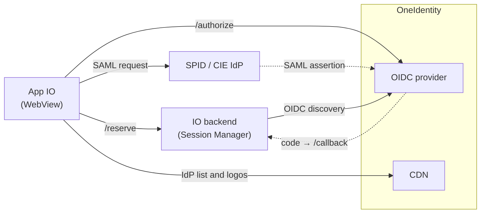
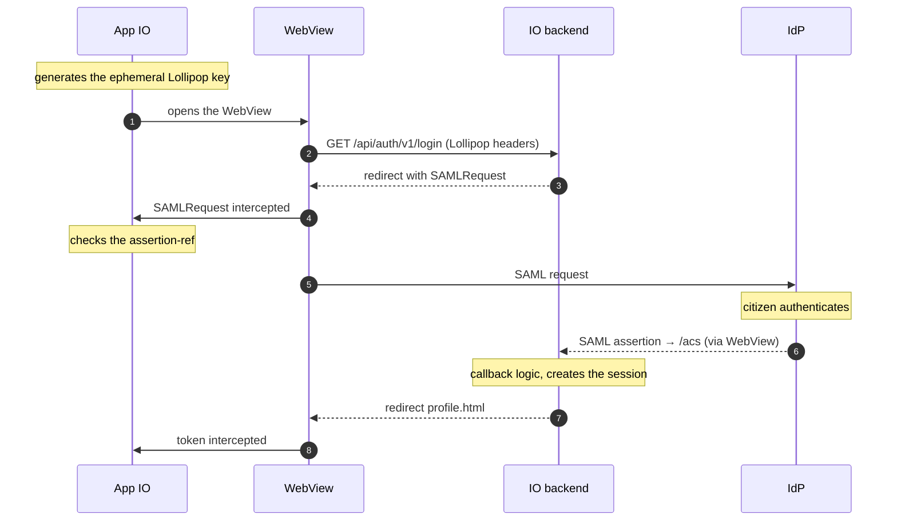
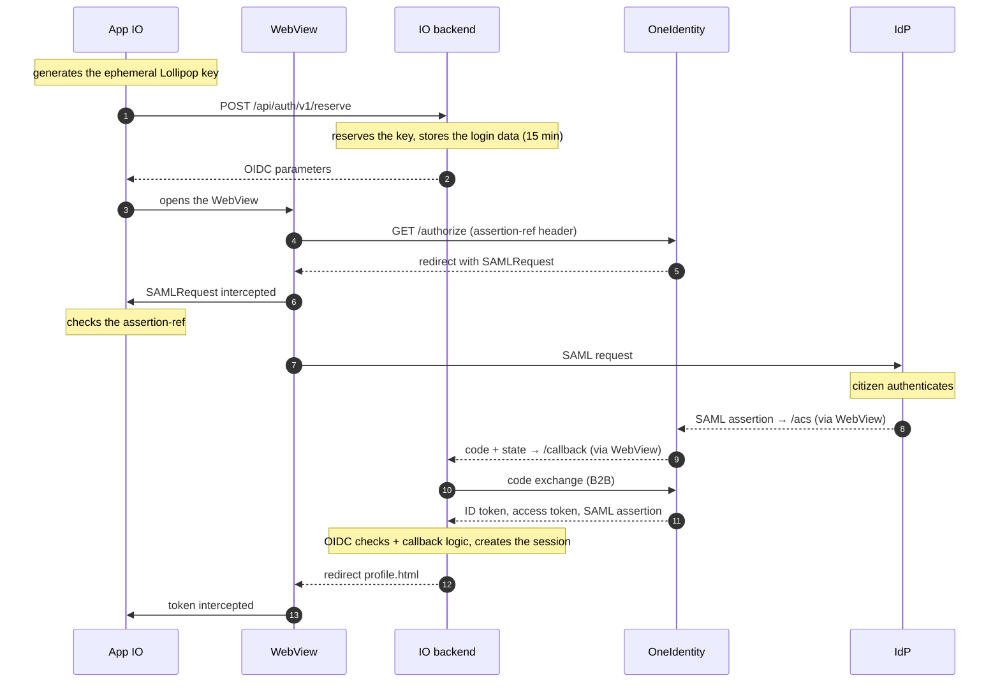

# Authentication in App IO

## Context

**Before.** IO ran the whole login stack itself: the IO backend built the SAML requests and verified the Identity Providers' assertions. Security patches and new capabilities, such as login for minors, all fell on the IO team.

**OneIdentity.** The internal service PagoPA products use to authenticate citizens with SPID and CIE. It speaks SAML to the IdPs and exposes an OIDC flow to the products. A dedicated team maintains it, and it lets PagoPA hold a single AgID membership.

**Now.** IO is an OIDC client of OneIdentity. IO keeps:

- the integration with the OIDC flow (`/reserve`, `/authorize`, `/callback`);
- Lollipop, the citizens' proof of possession (section 5);
- the on-device operations: reading the CIE over NFC with the PIN, and handing off to the CieID app.

**Transition.** IO is migrating from one stack to the other: the IO stack is being phased out, the OneIdentity stack is rolling out per device (section 4.1) and will eventually be the only one. Until then the two stacks coexist; flows and screens are the same for the citizen.

Technical terms are explained in the [glossary](#glossary) at the end.

### Who talks to whom

With the OneIdentity stack the app talks to four systems. Dashed arrows are redirects that go through the WebView's browser.

## 1. The three flows

The app tells the three login flows apart through the `LoginType` type. Each one can run on either stack, IO or OneIdentity, and uses Lollipop the same way; what changes is when the flow starts, which checks it runs and where it takes the citizen at the end. If the opt-in is enabled, in all three the citizen also chooses the session length (section 3).

| Flow                 | `LoginType` | When it starts                                                                             | Methods                | Differences                                                                             | At the end                                        |
| -------------------- | ----------- | ------------------------------------------------------------------------------------------ | ---------------------- | --------------------------------------------------------------------------------------- | ------------------------------------------------- |
| First login          | `auth`      | Citizen not authenticated, from the landing screen                                         | SPID, CIE + PIN, CieID | —                                                                                       | App startup                                       |
| Active session login | `reauth`    | Session about to expire: blocking screen at startup, then banner                           | SPID, CIE + PIN, CieID | The identity must match the session's: the app sends the fiscal code hash (section 4.4) | Messages home, with the new session and no logout |
| Sign with IO         | `FCI_auth`  | The citizen starts a signature and the session is not L3 (check enabled via remote config) | CIE + PIN              | Active session login with `flow: "FCI"` and level L3                                    | Back to the signature                             |

## 2. Identification methods

The methods are the same on both stacks. The level is the one the app requests from the IdP (`SpidL2` or `SpidL3`).

| Method    | How it works                                                                                                                                     | Requested level | Notes                                                                                                                                                                                                                                   |
| --------- | ------------------------------------------------------------------------------------------------------------------------------------------------ | --------------- | --------------------------------------------------------------------------------------------------------------------------------------------------------------------------------------------------------------------------------------- |
| SPID      | The citizen picks the IdP from the list and authenticates in the WebView                                                                         | L2              | IdP list: on the IO stack from IO static content (`/spid/idps/list.json`, with a fallback list bundled in the app); on the OneIdentity stack from OneIdentity (URLs in remote config), with logos from the `assets.oneid.pagopa.it` CDN |
| CIE + PIN | The citizen enters the PIN; the WebView starts the login, the app reads the card natively over NFC, then the WebView completes consent and token | L3              | The only method accepted by Sign with IO. On the IO stack, if NFC is off, a screen asks to turn it on                                                                                                                                   |
| CieID     | The WebView starts the login and hands off to the CieID app; the citizen authenticates there and returns to IO                                   | L2              | If the CieID app is not installed, the app says so. If only level 3 is set up in the CieID app, the login completes at L3                                                                                                               |

## 3. Session lifecycle

The session length depends on the login type: standard (30 days) or fast login (`LV`, 365 days). Fast login requires the `fastLogin` feature flag; if the opt-in is also enabled, the citizen decides, otherwise it is always on. The type travels with the login request (section 4.4).

| Phase                                                                            | Standard login           | Fast login (LV)                                                                                                     |
| -------------------------------------------------------------------------------- | ------------------------ | ------------------------------------------------------------------------------------------------------------------- |
| Session length                                                                   | 30 days                  | 365 days                                                                                                            |
| Token expired during the session (401)                                           | Session expired → logout | Token refresh: the app asks for confirmation and the unlock code, then `nonce` + `/fast-login` signed with Lollipop |
| App unlocked with the IO unlock code, after at least 2 minutes in the background | No action                | Silent token refresh                                                                                                |

**Expiry warning.** Applies to both types, if active session login is enabled via remote config. When fewer days than the threshold remain (`loginConfig.notifyExpirationThreshold`, with separate values for standard and fast login), a blocking screen appears at startup, only once; after that the banner appears. Both lead to the active session login, which creates a new session without logging out. If the citizen ignores the warning, they will have to do the first login again when the session expires.

## 4. The two stacks

### 4.1 Stack selection

The stack is chosen per device. The local flag in the Login Config Screen wins (section 7); if it is not set, the percentage rollout from remote config decides, computed on the deviceId (`isOneIdentityLoginEnabledSelector`). The stack the session was opened with is stored (`isOneIdentityLogin`).

### 4.2 IO stack (being phased out)

The IO backend speaks SAML directly to the IdP: it builds the request and verifies the assertion.

The login data travels in the headers and query of call 2 (section 4.4).

### 4.3 OneIdentity stack (rolling out)

OneIdentity speaks SAML to the IdP; IO speaks OIDC to OneIdentity.

The app calls `/reserve` directly, and it returns the parameters for `/authorize`: `authorization_endpoint`, `client_id`, `redirect_uri`, `state`, `nonce`, `acr_values`. From these the app builds the `/authorize` URL, adding the chosen `idp`, `scope=openid` and `response_type=code`. On this stack `/acs` belongs to OneIdentity, not to the IO backend. From step 12 onward the flow is the same as on the IO stack.

Steps introduced with OneIdentity: 1, 2, 4, 9, 10, 11.

### 4.4 What the app sends at login

| Data                                        | IO stack (`GET /api/auth/v1/login`)               | OneIdentity stack                                        |
| ------------------------------------------- | ------------------------------------------------- | -------------------------------------------------------- |
| Lollipop public key                         | `x-pagopa-lollipop-pub-key` header                | `lollipop_pub_key` in the `/reserve` body                |
| Key hash algorithm                          | `x-pagopa-lollipop-pub-key-hash-algo` header      | `lollipop_hash_algo` in the `/reserve` body              |
| Login type                                  | `x-pagopa-login-type: LV` header, fast login only | `login_type` (`LV` or `LEGACY`) in the `/reserve` body   |
| Fiscal code hash, active session login only | `x-pagopa-current-user` header                    | `current_user` in the `/reserve` body                    |
| Requested level                             | `authLevel` (`SpidL2` or `SpidL3`) in the query   | `min_auth_level` in the `/reserve` body                  |
| Chosen IdP                                  | `entityID` in the query                           | `idp` in the `/authorize` query                          |
| OneIdentity environment                     | —                                                 | `env` (`PROD` or `UAT`) in the `/reserve` body           |
| Key thumbprint (assertion-ref)              | —                                                 | `x-pagopa-lollipop-assertion-ref` header on `/authorize` |

### 4.5 What the backend does

**OneIdentity stack only.** At `/reserve` the Session Manager reserves the Lollipop key and stores the login data for 15 minutes (login type, current user, assertion-ref, minimum level, environment, nonce): a login that has started must finish within that time. At `/callback` it receives `code` and `state`, retrieves that data and exchanges the `code` with OneIdentity, getting an ID token, an access token and the SAML assertion. It then checks that:

- the fiscal code in the ID token matches the one in the SAML assertion;
- the assertion's `InResponseTo` matches the stored assertion-ref: this is the last link of the Lollipop binding (section 5);
- the level obtained is not lower than `min_auth_level` (no downgrade).

**Both stacks.** After `/acs` on the IO stack and after `/callback` on the OneIdentity stack, the callback logic is the same:

1. active session login: if the fiscal code differs from the session's, error 1004;
2. blocked user: if the session is blocked it returns 403; if the citizen has locked access from IO-Web, error 1002;
3. revocation of the previous session and Lollipop key, activation of the new key;
4. creation of the session token, retrieval or creation of the IO profile, login event sent;
5. redirect to `profile.html#token`.

A technical error in any of these steps returns 500.

### 4.6 What the app does after the token

The app stores the token in the authentication state, which is persisted in the Keychain, and starts initialization. The first backend call checks the session: if it returns 401, the session has expired or, with fast login, the token refresh starts (section 3). The same call returns the session information, including the expiry (`expirationDate`, used for the expiry warning) and the level (`spidLevel`, used by Sign with IO), plus the tokens for the other services.

### 4.7 What is simplified

- The diagrams leave out intermediate redirects, the IdP consent screen, the CIE NFC reading (between the SAML request and the assertion) and the hand-off to the CieID app. Step 11 of the OneIdentity stack merges two calls: the `code` exchange and the retrieval of the SAML assertion with the access token.
- **CIE + PIN.** On the IO stack the app, not the WebView, follows the redirects up to the `SAMLRequest` natively. On the OneIdentity stack the same behaviour is enabled via remote config; remote config also enables, on Android, clearing the session cookies before the login.
- The app-side steps are checked against the io-app code; the backend ones (section 4.5) come from the OneIdentity design review, in particular the [Login Happy Path diagram](https://www.planttext.com/?text=dLPHR-Cs37wUVWMHlYJ65RiRC0mesk3S9hq5IzSiJWiSYi9GB2OHuaYU9AVhVlqeEN5iTxiUrWUXfYJouyUFL3vRnuqhTpdqfdej5VpAY-8LPjnjUin9boDqxOmLT4Lcik3AGJoR0RT0korpBq5hfLPmnnLVe-dvGtRNFdElS38AErgX54nmnvVS8lJYqifSSWFMQKFtmo63Gbh6x5OgSiDtyBjsc6ouq2zIhU4NndZfj2ftIpJGkrmEdpv-VEunTdK5SxHezWXNLtGeStBF7GRCZ1OuVpfRvYK-3mdX1LncEjVcmbk6JxFxPF5SNqSb2YsLE_cWb9WY6A3t59ISVI3B3r5qhOLdYr2YGsEZY07zeTf7q2-v0ssWC5eCWdadLKhGDscEUyohexbdFNMl1ORFh3G6bKjB0dBOptDPw28jocMwnTUeRTrmkqbvljQCC8D7ICJjpeS-mUdXK1M3eWkHumitsCY4ieYY19589r2-MXR_B55b24BoDUL5APrSUzz74hiSVa65ndDrFndTU7_qlu2YvWRwcHO8gro_3Be8MWoIL9t7I23QMHqZ1u6qWoUSoiQFQl82WnLn_sF6ytp9ioqGeQTgLWexOQY-e-YtyLUAFnydu_dZ-Fmo01cI_J6UFenf9n2vyBKwrEd1bubRMXqrmHnNBCibsIU2KR5ZglNKbvhIs4F_8LvuFSpczwF18RqeMYocvFZJpruSfKDxoZY0WWRTJ60dWr1g4kC5ATULHeN4cyVeqXlLHX79lD2A-i-hDqYsGfrIRm9Kz0DK2264CfYH9esaJvwPTCy9KWEgRpsVh3RoxqFp5SK1cMz-GSwbUwsKKQdHom3wJUg0h1la0iqWEBmvbgxsvnLtgmr9MDYgndl9eIvn_uXqmDuXu8-7yVmhpE9vV3TUZES9SU2rUL3UzsgEE3SIkxhhgYoixrRnk1y6P3lCzK_N43e7_yesNAqREgx6QLZ_ioqd8rZeBIhWb5QSPJIlAqCJIENe7I1rlabyDuNuMBfGX9RZT_1zEt0NFpoYaIkPSH_BjWR7X-hsMHSGTVwEPc-smMnBkpK3DxTmFeI4qojuEdnpIqVYZWxhYewyojvUcgXZ3oqqh2JceehZGfowxs7e-wBfgZaLeAyqqAEcQCmA7FpB1AzRu9gSA4-mVwIp_p-_xUxfR6qGrNDxRXnVyJV2Q5ShlAIVoHtzaFW7).

The server-side components (Session Manager, Redis, Lollipop and Profile functions, CosmosDB, Service Bus) are in the [IO–OneIdentity container diagram](https://www.plantuml.com/plantuml/uml/ZLPBZzis4BxxLqnrA6H0ZIyv5KKHFtOJ0OdjsWw2dXQKDFQoIv4gITbrYlxt3X-MxPMDpSNXShxvvi5lHlbWBDEshSNW9ovBqLO8lqtVZwRldwPAMiObwjylJEnxgt4qThzJLTTAzesvjBZJp78b0t2DUizBdBIc3vunomfcq9muJQtChEW3ALhJsXZwiPMbuty3DcwQ6BiFN5kbsIu2_sYnnNZJXtx38l8jyozC4gP6QVkuETg3qYzSxhhmWfU-4H-PnGCxlbd_2YjkfgnyfZG6bbk1a7Jl03FEgB7rhv0lVbb8XBn2IQ1ZClWy_dFnTVEqMIoVPejlytGu62nH6oNJrg3Eag_qcz3bO7qq5kkdYMfbnVGnvOgop2395_155PpYNMIT3E7V0K2NG5fxIF2WNyeZeTCAMMbXJYvxT7zVC81zPXPGiaAWWP9R_Xsb0Qk0bIKQ0qrR41POLNF9ZTN1ouHNCvJoV_sSbKHUPSbL1uOkqGXy-CS6J55aoQJbeg8dWObGvKkI9KuXJ1w1IujQCW6BV3Q5WsPDWngOTb5WlSndesd-0AorpnIYQyYDA6KbYNKslvqihveiET5r-S9IgpslKFSI9to1MP9NIoXO-OAoShmtNoxQ2Ro0ISGItHtjfLJWxf1TlKuqKLUMWjcjqZNSC5C2h-OuZGzKj2PB7lPKaol8FQZIJW4U3X4Fv40K_GcYZ7YT9UxkAeDb3cSGUVP6DENIM2Q4pz9uIv0uv9S6y1QYzlz2T2R2VYiVEOiT3BEmGLR3exDxglEx_GpZ8DpO_3WYhzPDQWX2Vg4CFLwkYNOTxc9jlazpLM46csE3fjIyiNGNwZXXgHScWpGk3HEqgf4An0eeVAEuj6ReTVbgWQJQ7RF4tr0JOlbqycQWNb_JDKop6Yrgqz5rYpOLIWZUgCQBxNFyWxZ2IvzWDnmRhRPSeFTRXlDzjsx_dneOaywwviMBZY8wJFoGk35PeGWxBsmsrqu3T2A0CvqtMBSX5XAxv-MIMzWATQ00dpQRvRhd5kTpVBKNoC_m2k60nPxZVUSuWl530Hh_Rj5O0_PPgtRt3ET1lajnNZbHY6vJSBbL1b9yjti7GkqKQKPmOuUlM4BuC7KhrLekTpq4sVhYlOFk0xkcUcNbnhIeWVHNgZtguyZlLP_ne-PKfJY29Cr1gIJP7TUR4QAgdGxGWCMwKPfckDCaC5dTrNMS1YT4gqebxaRfoI-4kvnD0-xRdVZzTPVdF3OhT3ip_g-8L1-EeBRWrDebUt8uVHXVy7XgoMZriDxSZTJDsKUqewb6OWlfdkVknuXkxTOLxjKB6c0oP1jcRwuitvucu5DRN6tVDneJH9ZBFHEyOjPp7w7HkEUgDH0Tm59ODrtWFX9GqkBwmIekFr1hKfe1T9yf0nftJ5UavL09JGkNVk8X3MUd7ur_OMd1kiKyx2hvG3njBVu7).

## 5. Lollipop

Lollipop is IO's _proof of possession_: it proves that a request comes from the device that did the login. IO keeps it because OneIdentity does not handle it, and it works the same way on both stacks, except for the details below.

In short: at every login the phone creates a key pair. The public key's thumbprint becomes the ID of the request to the IdP, which by signing the assertion certifies that the key belongs to the citizen. From then on, sensitive requests, signed with the private key that never leaves the device, prove they come from that phone.

1. **Generation.** At every login attempt the app deletes the ephemeral key and generates a new pair. The private key stays in the device's secure area (Secure Enclave or Keystore); the app only knows its `keyTag`. A new key at every attempt keeps it unique: the backend rejects an already reserved key with 409.
2. **Sending the public key.** Only once, during the login (section 4.4).
3. **Binding to the identity.** The public key's thumbprint (`sha256-<thumbprint>`, the _assertion-ref_) becomes the ID of the SAML request. Before moving on to the IdP, the app checks that the ID matches its own key. The IdP replies with a signed assertion that quotes that ID.
4. **Login outcome.** If the login succeeds, the ephemeral key becomes the main key and a new one is prepared for the next login; if it fails, it is discarded.
5. **Signing requests.** Sensitive requests (Sign with IO, SEND, fast login refresh) are signed with the private key following the HTTP Message Signatures standard (`signature`, `signature-input`, `content-digest`). The others only use the session token.
6. **Verification.** Whoever receives a signed request verifies the signature with the public key bound to the citizen.

**What differs between the stacks.** Besides how the public key travels (section 4.4), the OneIdentity stack adds two checks to the identity binding: the key thumbprint travels in the `x-pagopa-lollipop-assertion-ref` header of `/authorize`, and at `/callback` the backend checks that the assertion's `InResponseTo` matches the stored assertion-ref (section 4.5).

## 6. Errors

Errors reach the app in two ways:

- **Error code from the backend.** The final page of the flow is `error.html?errorCode=…&errorMessage=…`: the WebView intercepts it without loading it, and the app shows the screen for that code, either with retry or as a permanent error. Applies to both stacks.
- **Error during the flow.** An HTTP error in the WebView, or a failed app-side check, stops the login before it reaches the final page.

| Case                                                                                                                                                  | What the citizen sees                                                |
| ----------------------------------------------------------------------------------------------------------------------------------------------------- | -------------------------------------------------------------------- |
| SPID codes: 19 too many attempts, 20 insufficient security level, 21 timeout, 22 consent denied, 23 identity suspended or revoked, 25 login cancelled | A dedicated message for each code                                    |
| 1001                                                                                                                                                  | Minimum age not reached (18)                                         |
| 1002                                                                                                                                                  | They locked access to IO from IO-Web: screen to unlock it            |
| 1004                                                                                                                                                  | Fiscal code different from the session's (active session login only) |
| Lollipop check failed                                                                                                                                 | Login stopped with an error                                          |
| HTTP error in a step of the flow, OneIdentity stack (`/reserve`, `/authorize`, IdP pages, `/acs`, `/callback`)                                        | Generic error screen                                                 |
| Callback fails to load during an active session login                                                                                                 | Forced logout and back to the landing screen                         |

CIE reading errors (wrong PIN, invalid or expired card, APDU not supported) have dedicated screens.

## 7. Configuring the app for testing

The Login Config Screen (easter egg on the landing screen) sets three values, which are persisted:

- **Stack.** Forces the IO stack or the OneIdentity stack, instead of the rollout.
- **OneIdentity environment.** PROD or UAT (`io.oneid.pagopa.it` / `uat.io.oneid.pagopa.it`); applies to the OneIdentity stack only.
- **CIE environment.** Applies to both stacks, for CIE + PIN and CieID only. Production (default): real CIEs, `idserver.servizicie.interno.gov.it`, CieID app `production`. Pre-production: test CIEs, `preproduzione.idserver.servizicie.interno.gov.it`, CieID app `preprod`; when it is active, the CIE button on the landing screen is red.

## 8. Where to start in the code

| What                                                 | Where                                                                                                                                                          |
| ---------------------------------------------------- | -------------------------------------------------------------------------------------------------------------------------------------------------------------- |
| Login types, headers, reading the token from the URL | [`authentication/common/utils/index.tsx`](../../apps/main-app/ts/features/authentication/common/utils/index.tsx)                                               |
| Choosing between the two stacks' screens             | [`authentication/common/navigation/AuthenticationNavigator.tsx`](../../apps/main-app/ts/features/authentication/common/navigation/AuthenticationNavigator.tsx) |
| OIDC flow: `/reserve`, `/authorize`, Lollipop check  | [`lollipop/hooks/useOneIdentityLoginSource.tsx`](../../apps/main-app/ts/features/lollipop/hooks/useOneIdentityLoginSource.tsx)                                 |
| First login                                          | [`authentication/common/saga/authenticationSaga.ts`](../../apps/main-app/ts/features/authentication/common/saga/authenticationSaga.ts)                         |
| Active session login                                 | [`authentication/activeSessionLogin/saga/index.ts`](../../apps/main-app/ts/features/authentication/activeSessionLogin/saga/index.ts)                           |
| Fast login refresh                                   | [`authentication/fastLogin/saga/tokenRefreshSaga.ts`](../../apps/main-app/ts/features/authentication/fastLogin/saga/tokenRefreshSaga.ts)                       |
| Lollipop                                             | [`lollipop/`](../../apps/main-app/ts/features/lollipop/)                                                                                                       |
| Initialization after login                           | [`sagas/startup.ts`](../../apps/main-app/ts/sagas/startup.ts)                                                                                                  |
| Login Config Screen                                  | [`authentication/common/screens/LoginConfigScreen.tsx`](../../apps/main-app/ts/features/authentication/common/screens/LoginConfigScreen.tsx)                   |

## Glossary

- **Assertion-ref.** Thumbprint of the Lollipop public key (`sha256-<thumbprint>`), used as the ID of the SAML request.
- **CieID.** Official app for authenticating with the CIE identity; IO hands the citizen off to it and gets them back once the login is done.
- **CIE.** Carta d'Identità Elettronica, the Italian electronic identity card.
- **Fast login (LV).** Login with a 365-day session and token refresh (section 3).
- **IdP (Identity Provider).** Whoever authenticates the citizen: the SPID providers, or the Ministry of the Interior for CIE.
- **L2 / L3.** SPID security levels: L2 with password and a second factor, L3 with a physical device (for CIE, card and PIN).
- **Lollipop.** IO's proof of possession (section 5).
- **OIDC (OpenID Connect).** Authentication protocol built on OAuth 2.0. IO uses it with OneIdentity in the _authorization code_ flow: OneIdentity returns a `code`, which the backend exchanges for the tokens.
- **SAML.** Protocol used with the IdP to exchange the authentication request (`SAMLRequest`) and the signed assertion (`SAMLResponse`).
- **SAML assertion.** Document signed by the IdP with the citizen's identity, in reply to a SAML request.
- **Session Manager.** IO backend component that handles login and sessions.
- **SPID.** Sistema Pubblico di Identità Digitale, the Italian public digital identity system.
